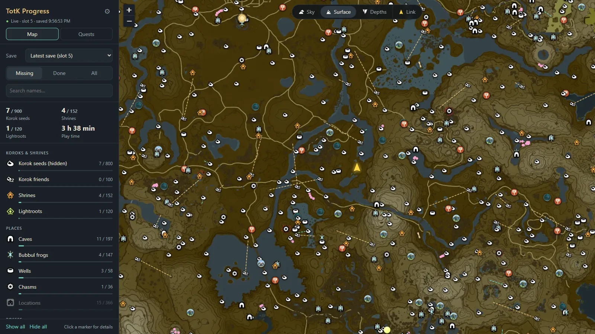
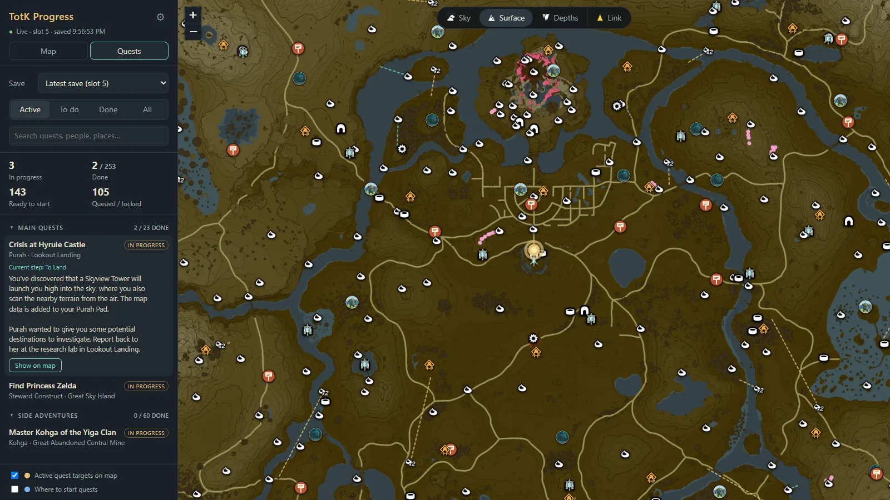
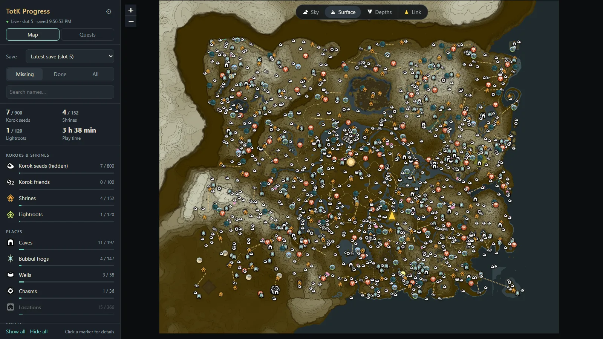

# TotK Progress Map



A companion app for [TotK Recomp](https://github.com/valentderah/totk-pc-recomp), the native PC port of *Tears of the Kingdom*.
It reads your save and shows what you have and haven't
found on the map: Korok seeds (with their puzzle paths), shrines, lightroots, caves, Bubbul frogs,
wells, chasms, locations, bosses, Sage's Wills, old maps, Addison's signs, schema stones and Yiga
schematics, on the sky, surface and depths layers. A yellow arrow marks where Link was when the
game last saved; the **Link** button at the top jumps there.

The **Quests** tab lists all 253 adventure-log quests (Main Quests, Side Adventures, Side Quests,
Shrine Quests) with their status (in progress, not started, locked, done), the quest giver and
region, and the adventure log text of the step you're on. "Show on map" jumps to the current
step's destination, and active quest targets can be shown on the map (gold).

For quests you haven't started, "Where to start quests" puts a blue **!** where the quest giver
stands (160 quests; NPCs may walk around during the day) or, when the game data doesn't place the
giver, a lighter **!** at the quest's first destination (92 quests, approximate).

Status meanings: **Locked** = the game hasn't unlocked it yet; the app evaluates the quest's
prerequisite from the game data against your save and names the quests it waits on. **Not started**
= unlocked; talk to the quest giver to begin. Some givers only appear after story events, which
the quest data doesn't describe, so "not started" isn't a guarantee the giver is there yet.
**Queued** = unlocked in the save, but the same character hands out the previous quest of the
series first (e.g. Hoz: Bring Peace to Hyrule Field! before ... to Necluda!). The game decides that
in dialogue scripts; the app infers series from quests by the same NPC that are next to each other
in the adventure log (36 quests). Letters, statues and the Mysterious Voice aren't series.

| Quests tab | The whole map |
|---|---|
|  |  |

It re-reads the save every few seconds, so the map updates on its own whenever the game saves.
It only ever reads your game and save files; it never writes to them.

## Get started

You need [TotK Recomp](https://github.com/valentderah/totk-pc-recomp) installed with your game files (tested with game
versions 1.2.1 and 1.4.3). The app builds its map, collectibles and quests from those files.

1. Download `TotKProgressMap.exe` from [Releases](../../releases/latest) and put it anywhere.
2. Double-click it. The app window opens with the setup page (Windows may say the app is unrecognized:
   *More info* → *Run anyway*; the exe isn't code-signed).
3. Pick your TotK Recomp folder (the one with `totk.exe`). The app looks on your drives and usually
   finds it; otherwise click **Browse…**. It tells you if the folder has game files and saves.
4. Click **Set up**. It draws the map and finds every shrine, Korok, cave, boss and quest in your own
   game files (about a minute). Then the map opens with your progress.

Close the window to stop the app; opening the exe again while it runs brings the window to the front.
**⚙** at the top of the panel changes the game folder and has *Open in browser*, to show the same map
in your web browser too.

**On your phone:** click the phone button at the bottom right of the map, *Turn on*, and scan the QR
code (also in ⚙). Only phones and tablets on the **same Wi-Fi or network** as your PC can open it (not
over mobile data). They get the same map, read-only: they can't change settings or anything on your PC (Windows
may ask once to allow the app on private networks). It stays on until you turn it off.

The map starts with a few categories (shrines, lightroots, caves, Bubbul frogs, collectibles) because
all ~2,000 markers at once are slow; turn on more in the legend. Your choices (legend, filters, layer,
tab) are saved by the app and kept when you close it. The window uses Microsoft Edge WebView2, which comes with Windows 10 and 11;
without it the app uses your browser instead and you stop it with **⚙** → *Quit app*.
Settings and downloaded data are kept in `%LOCALAPPDATA%\TotKProgressMap`; delete that folder to reset.

## Run from source

Needs Python 3.10+. Double-click `start.bat`, or:

```
pip install -r requirements.txt   # zstandard, to read the game's compressed files
python server.py                  # opens http://localhost:8787/ and walks you through setup
```

Running from source keeps data next to the code (`assets/`, `config.json`). `build_exe.bat` builds
`dist\TotKProgressMap.exe` with PyInstaller; pushing a `v*` tag builds it on GitHub Actions and
attaches it to a release.

Command-line tools: `python build_mapdata.py --romfs <install>\romfs` extracts the map data,
`python -c "import gamefiles, maptiles; maptiles.build_tiles(gamefiles.Romfs(r'<install>\romfs'), 'assets/tiles')"`
draws the map tiles, `python build_icons.py --romfs <install>\romfs` the map icons,
`python build_quests.py [--romfs DIR] [--lang EUen]` rebuilds the quest list (other
languages: `EUen`, `EUfr`, `EUde`, `JPja`, ...). `server.py` options: `--save-dir <folder>` (read
saves from there instead of the configured install), `--port 8787`, `--host 127.0.0.1`, `--browser` (use the browser instead of the app window),
`--no-browser` (no window or browser, just the local server).

The map page loads Leaflet from cdnjs, so the browser needs internet.

## How it works

- `savefile.py` reads `progress.sav`: a table of `(u32 hash, u32 value)` pairs from offset `0x28`
  up to `MetaData.SaveTypeHash` (`0xa3db7114`), whose value points at a `u64` GUID array.
  An object is done when its completion hash has a non-zero value; shrines and Korok friends need
  `Clear`, lightroots `Open`. Sage's Wills and Addison's signs are done when their GUID is in the array.
- Quests: the game's Challenge table lists each quest's steps (`Ready`, `Step1`, `Step1a`, …,
  `Complete`) with destination points; the save holds an enum `Step_<quest>` whose value is the
  murmur3 hash of the current step name (`NotReady` = locked, `Ready` = not started). The message
  file `ChallengeMsg/Info_<quest>` has the quest name and the log text under the same step labels.
  A quest's prerequisite (`DependFlagName`) is a flag or a BoolExp from `GameData/GameDataList`: a
  postfix program (0 GetBool, 10 BoolExp, 1/12 + 2 enum `==`/`>` value, 3 AND, 4 OR, 5 NOT) that
  `savefile.evaluate` runs against the save.
  `gamefiles.py` has small readers for the formats involved (zstd with the game's dictionaries,
  SARC, MSBT, BYML).
- `server.py` serves the page and `/api/slots`, `/api/progress?slot=latest|0-5`. "Latest" is the slot
  written most recently. It only reads the save folder, never writes to it.
- `web/` is the map (Leaflet). World `(x, z)` maps to pixel `750 + x/8, 750 + z/8` on a 1500 px map;
  height `y >= 750` is sky and `y < -50` is depths.

The map, the collectibles and the quests are read from your own TotK Recomp game files on your PC
(`maptiles.py`, `build_mapdata.py`, `build_quests.py`, `build_icons.py`); see [docs/PROGRESS.md](docs/PROGRESS.md)
for the formats and save flags. The map icons are the game's own map, item and compendium icons, also
taken from your files; the app's own SVG icons (`web/icons/`) are used when they're not available.
Korok puzzle types and routes come from the game's placement data too. Nothing is downloaded, and
nothing game-derived is shipped in this repository, so the app needs TotK Recomp's game files.

## License

The code in this repository is under the [MIT License](LICENSE). It covers this project's own code
only: the game data and maps that the app builds or downloads into `assets/`
come from *The Legend of Zelda: Tears of the Kingdom* and are not part of it. This is an
unofficial fan project, not affiliated with or endorsed by Nintendo.
